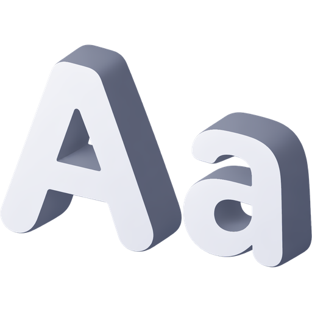
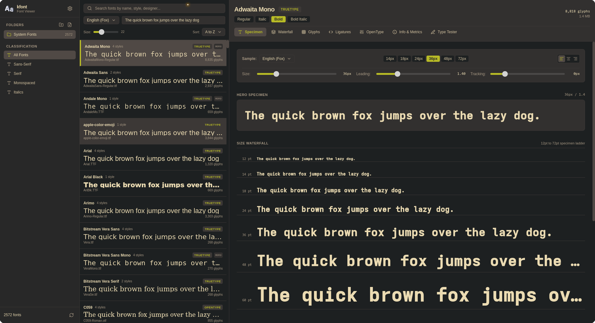

<p align="center">
  
</p>

# kfont

Fast local font viewer, typography inspector, and ligature tester built with Rust, Tauri v2, Svelte 5, and Tailwind CSS v4.



## Overview

`kfont` is designed for inspecting and testing locally installed system fonts and font collections without internet connections, auto-installation routines, or cloud accounts. It parses font binaries directly on disk via zero-copy Rust parsers and renders previews through virtualized lists and custom binary streaming protocols.

## Key Features

- **High-Performance Scanning**: Discovers and extracts metadata from 2,500+ font files in under 150ms using `ttf-parser` in Rust.
- **Asynchronous Binary Protocol**: Uses a custom `kfont://localhost/` URI scheme and binary IPC fallback to stream raw font bytes directly into the webview font engine without Base64 or JSON overhead.
- **Virtualized Font List**: Smooth scrolling across thousands of font families with 30-item overscan buffers and frame-synchronized updates.
- **Specimen Viewer**: Preview pangrams in English, Russian Cyrillic, alphabets, numbers, or custom text with dynamic font size, line height, letter spacing, and text alignment.
- **Waterfall Ladder**: Multi-scale waterfall ladder from 12pt to 72pt.
- **Character Map**: Complete glyph grid indexed by Unicode code point with search by hex code (e.g. `U+0041`), category filtering, decimal, and HTML entity copy.
- **Ligature Tester**:
  - **Ligature Grid**: Categorized catalog of programming ligatures (arrows, comparisons, assignments, comments, functional operators, delimiters).
  - **Code Editor**: Live interactive sandbox with syntax snippets in TypeScript, Rust, Python, Haskell, and Markdown.
  - **Side-by-Side Diff**: Split-screen view comparing text with ligatures enabled (`calt 1, liga 1`) versus disabled (`calt 0, liga 0`).
- **OpenType Inspector**: Toggle OpenType feature tags (`liga`, `calt`, `dlig`, `smcp`, `onum`, `tnum`, `zero`, `frac`) live.
- **Metrics and Metadata**: Units per EM, ascender, descender, line gap, weight, width class, vendor, designer, license details, and file location.
- **Declarative YAML Configuration**: Stores settings, active sources, custom directories, and custom themes in `~/.config/kfont/config.yaml`.
- **Theme Presets**: Gruvbox Dark (`#b8bb26` green accent), Gruvbox Light, Monokai, Catppuccin Mocha, Catppuccin Latte, Dracula, Solarized Dark, and Solarized Light, plus a GUI theme creator.

## Configuration

Settings are saved declaratively to `~/.config/kfont/config.yaml`:

```yaml
general:
  active_theme: "gruvbox-dark"
  scan_system_fonts: true
  preview_text: "The quick brown fox jumps over the lazy dog"
  list_font_size: 22
  sort_by: "name-asc"

custom_folders:
  - id: "custom-my-fonts"
    name: "My Fonts"
    path: "/home/user/Fonts"

custom_themes:
  - id: "my-nord"
    name: "Nord Custom"
    bg_base: "#2e3440"
    bg_card: "#3b4252"
    bg_card_hover: "#434c5e"
    bg_card_active: "#4c566a"
    text_primary: "#eceff4"
    text_secondary: "#d8dee9"
    text_muted: "#e5e9f0"
    border_subtle: "#4c566a"
    border_strong: "#d8dee9"
    accent: "#88c0d0"
    accent_text: "#2e3440"
    badge_bg: "#434c5e"
    badge_text: "#88c0d0"
```

## Building from Source

### Prerequisites

- Node.js (v20+) and `npm`
- Rust toolchain (stable)
- Linux packages:
  ```bash
  sudo apt-get install -y pkg-config build-essential libssl-dev libgtk-3-dev libwebkit2gtk-4.1-dev libayatana-appindicator3-dev librsvg2-dev
  ```

### Development

```bash
# Install frontend dependencies
npm install

# Run desktop application in development mode
npm run tauri dev
```

### Production Build

```bash
npm run tauri build
```

Generated release artifacts:
- Binary: `src-tauri/target/release/kfont`
- Debian package: `src-tauri/target/release/bundle/deb/*.deb`
- RPM package: `src-tauri/target/release/bundle/rpm/*.rpm`
- AppImage: `src-tauri/target/release/bundle/appimage/*.AppImage`

